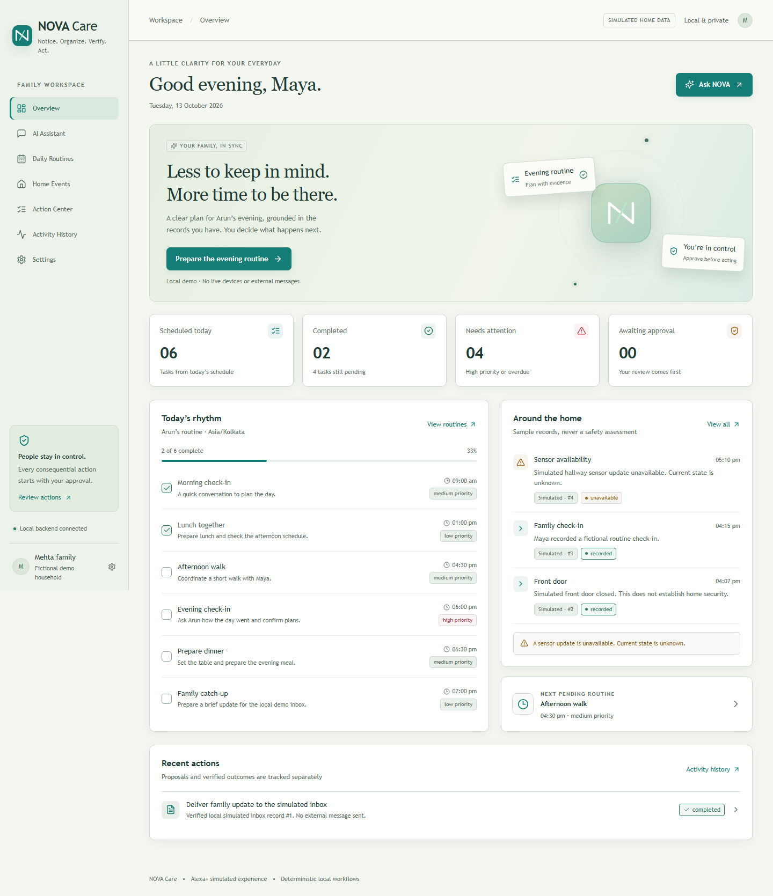
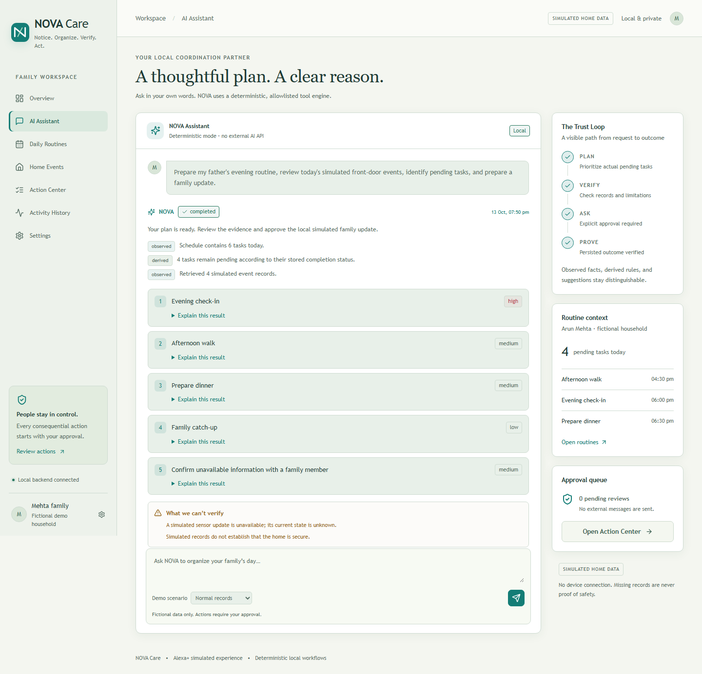

# NOVA Care

Notice. Organize. Verify. Act.

Created by Viraj Gundewar for the Amazon Developer Hackathon: Build, Ship, Shape — Alexa+ simulated experience track.

Copyright (c) 2026 Viraj Gundewar. All rights reserved by Viraj Gundewar.

This repository contains the source code, documentation, tests, screenshots and demo recording. It is for local execution and hackathon evaluation. No website hosting, GitHub Pages or cloud deployment is configured.

## Project overview

NOVA Care turns supported natural-language family requests into structured plans, checks fictional routine and home-event records, explains its conclusions and asks for explicit approval before a local simulated family update. Its Trust Loop is PLAN → VERIFY → ASK → PROVE.

All household data and device events are fictional and visibly simulated. A completed action means one verified record in the local simulated inbox, not a real email or SMS. No AWS, paid APIs, physical hardware or external language model is required.

## Repository and judging access

Repository: https://github.com/Virajcodes-1024/nova-care

This is a private, rights-reserved repository, not an open-source release. Before submitting, grant required reviewers access through GitHub Settings → Collaborators following the current official rules: https://amazonappdev2026.devpost.com/rules

Reviewer invitations and Devpost submission are not performed by this project.

## Screenshots and video




- [Actual MP4 walkthrough](demo/media/nova-care-demo.mp4): 1 minute 37 seconds, explanatory captions, no audio narration.
- [12 screenshots ZIP](demo/media/nova-care-snapshots.zip).
- [Individual gallery screenshots](demo/media/screenshots).
- [Project thumbnail](nova-care-thumbnail.png): AI-generated promotional artwork, separate from actual application captures.

The real recording shows planning, supporting evidence, simulated-event limitations, explicit approval, verified delivery, persistence after reload, history, missing data and rejection. Upload the video publicly to YouTube or Vimeo when filling the hackathon video field. No upload has been performed.

## Features

- Seven responsive pages: Overview, AI Assistant, Daily Routines, Home Events, Action Center, Activity History, Settings.
- Persistent routines, completion state, notes, conversations, workflow steps, approvals and ledger in SQLite.
- Deterministic intent routing and eight allowlisted backend tools.
- Prioritized plans with linked evidence and explainable rules.
- Explicit missing-record and unavailable-source scenarios; no unsupported safety claim.
- Reviewable drafts, native approval confirmation, rejection and duplicate-execution prevention.
- Verified local outcomes, server timestamps, filters, pagination and clear errors.
- Keyboard navigation, visible focus and reduced-motion support.

## Technology

React 19, strict TypeScript, Vite, Tailwind CSS, Lucide, React Router, TanStack Query, React Hook Form, Zod; Python, FastAPI, Pydantic, SQLAlchemy, SQLite. Pytest, Vitest, React Testing Library, Playwright, Ruff, ESLint and Prettier.

## Prerequisites

Node.js 22.12+ (tested with 24.19.0), Python 3.12+ and npm or pnpm. Free dependency installation requires internet once; essential app operation is local afterward. No account, credit card or API key is required to run the app after obtaining repository access.

## Clone

```sh
git clone https://github.com/Virajcodes-1024/nova-care.git
cd nova-care
```

## Install on Windows

```powershell
powershell -ExecutionPolicy Bypass -File scripts/setup.ps1
```

This installs Python packages into ignored .python-deps, installs frontend dependencies and explicitly initializes fictional fixtures. Existing seeded records are preserved.

## Manual installation

```sh
python -m venv .venv
```

Activate the environment on Windows:

```powershell
.venv\Scripts\Activate.ps1
```

Or on macOS/Linux:

```sh
source .venv/bin/activate
```

Then:

```sh
python -m pip install -r backend/requirements-lock.txt
npm install
node scripts/run.mjs seed
```

For exact frontend versions, use the committed pnpm lockfile:

```sh
pnpm install --frozen-lockfile --store-dir .pnpm-store --config.node-linker=hoisted
```

pnpm-workspace.yaml explicitly permits esbuild's installation script. npm install uses package version ranges and does not consume the pnpm lockfile.

## Start locally

Terminal 1:

```sh
node scripts/run.mjs backend
```

Terminal 2:

```sh
node scripts/run.mjs frontend
```

Frontend: http://127.0.0.1:5173

API documentation: http://127.0.0.1:8010/docs

Backend health: http://127.0.0.1:8010/api/health

Both servers bind to loopback. The scripts prefer .venv, then a detected bundled Codex Python, then python on PATH. Set NOVA_PYTHON to an executable if needed. No bundled Codex runtime is required on another computer.

## Configuration and persistence

Environment variables are documented in [.env.example](.env.example). The app does not automatically load .env. Export variables before launch; never commit real credentials.

- NOVA_DATABASE_URL: defaults to the absolute project-root nova.db.
- NOVA_TIMEZONE: defaults to Asia/Kolkata; demo/UI times use this timezone.
- NOVA_CORS_ORIGINS: explicit local frontend origins.
- NOVA_PORT: backend port, default 8010.
- NOVA_API_TARGET: frontend proxy backend URL, default http://127.0.0.1:8010.

Startup creates missing tables but never silently resets or reseeds records. Fixture dates remain the initialization day. Refresh today's fictional fixtures through Settings → Reset demo data and confirm, or explicitly run:

```sh
node scripts/run.mjs seed --reset
```

Reset deletes local conversations, approvals, deliveries and history. Normal restarts preserve them. Schema initialization uses SQLAlchemy create_all; future schema changes require explicit migrations.

## Try the main demo

1. Open Overview → Prepare the evening routine.
2. Select Normal records and send the prefilled request.
3. Inspect the plan, Explain this result, linked evidence and actual tool trace.
4. Open Action Center and review the draft and expected effect.
5. Choose Review & approve, then confirm. Success appears only after persistence verification.
6. Reload and inspect Activity History; the outcome remains saved.
7. Repeat with Missing records or Unavailable source to inspect explicit limitations/failures.
8. Prepare another update and reject it; no delivery occurs.

## Tests and checks

```sh
node scripts/run.mjs test
npm test
npm run typecheck
npm run lint
node scripts/run.mjs ruff
node scripts/run.mjs ruff-format
npm run format:check
npm run build
```

Browser tests:

```sh
npx playwright install chromium
npm run e2e
```

Tests use isolated temporary databases and separate e2e.db on ports 8017/5187. Browser tests do not reset normal nova.db. A workspace-local .browsers installation is supported; see [testing documentation](docs/testing.md).

Recorded verification: 25 backend tests, 6 frontend tests and 3 browser scenarios passed. Strict type checking, production build and quality checks passed. See [verification](docs/verification.md) for the actual environment and known warnings. These results do not imply exhaustive browser, security or load certification.

## Troubleshooting

- Empty today's dashboard on a later date: explicitly reset demo fixtures.
- Backend disconnected: start the backend and check the health URL above.
- Port occupied: set NOVA_PORT and matching NOVA_API_TARGET before launching.
- Python missing: install Python 3.12+ or set NOVA_PYTHON.
- Browser missing: install Playwright Chromium.
- Restricted Windows socket errors: use a terminal allowed to access loopback sockets.

## Documentation

- [Architecture](docs/architecture.md) and [tool contracts](docs/tools.md).
- [Tests](docs/testing.md) and [verification](docs/verification.md).
- [Demo scenarios](demo/scenarios.md) and [video script](demo/video-script.md).
- [Product feedback](docs/product-feedback.md), [friction log](docs/friction-log.md) and [submission checklist](docs/submission-checklist.md).

## Actual integration boundaries

This is the alternate Alexa+ simulated web experience, with a deterministic local tool engine. There is no live Alexa+, Ring, Amazon SDK, AWS, MCP server, Ollama, SMS, email or external AI integration. Ollama/MCP remain optional future work.

Intent routing supports the documented request classes. Results appear after synchronous execution, not streamed fake progress. This is a fictional single-household, single-user demonstration without authentication, medical guidance, security certification or a tamper-proof ledger. Do not use real sensitive household data or expose the backend to the internet.

## Copyright and evaluation permission

Copyright (c) 2026 Viraj Gundewar.
All rights reserved by Viraj Gundewar.

See [LICENSE](LICENSE) for ownership and authorized hackathon evaluation permission. Third-party dependencies remain subject to their respective licenses; see [THIRD_PARTY_NOTICES.md](THIRD_PARTY_NOTICES.md). No live Amazon endorsement or integration is claimed.
