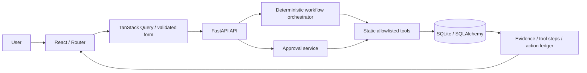
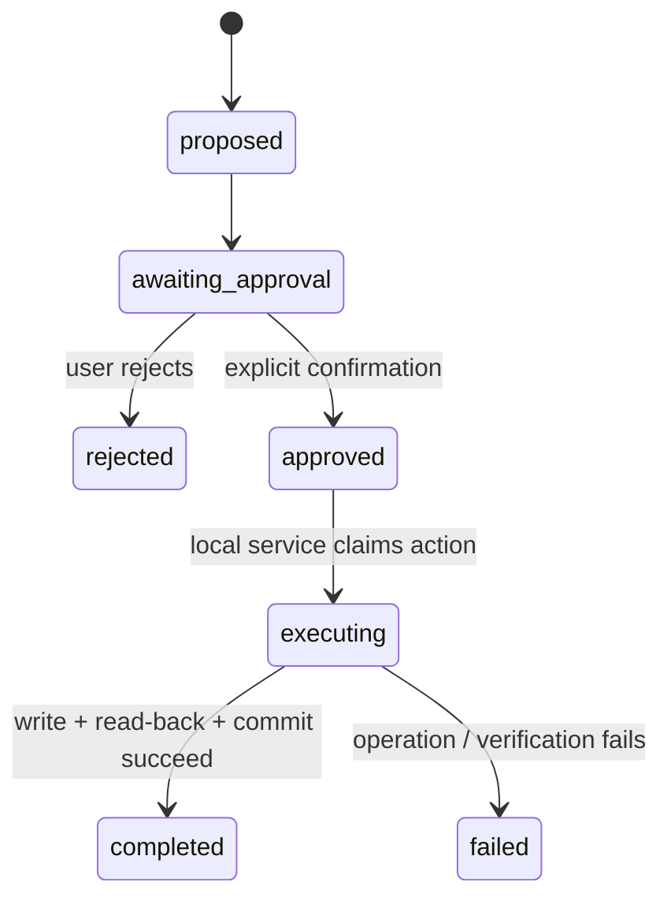

# Architecture

## Components

`backend/app/routes.py`: validated HTTP boundary with explicit response schemas. `schemas.py`: Pydantic schemas. `repository.py`: today's schedule, event retrieval, record projections. `tools.py`: input/output validation and static tool registry. `workflow.py`: deterministic intent selection and ordered orchestration. `services.py`: serialized approval/rejection and execution. `models.py`: relational tables and constraints. `config.py`: local environment configuration. `seed.py`: explicit fixture initialization/reset. `main.py`: startup/schema initialization and error/CORS handling.

`src/api.ts`: bounded fetch and consistent errors. `types.ts`: strict API types. `App.tsx`: responsive navigation and live connection indicator. `pages.tsx`: seven routed views and state mutations. `components.tsx`: evidence links, statuses, dialog, task/event rows. `styles.css`: ivory/sage/teal palette with serif headings and readable sans-serif body text, responsive layouts, focus and reduced-motion handling. Query invalidation refreshes dependent views after mutations.

## Flow and transparency

Interpretation maps documented keywords to evening routine, family update, event review, pending tasks, or unsupported. An unsupported request creates no action. A full routine workflow reads today's schedule → inspects simulated events → finds pending tasks → creates/validates a priority-first plan → drafts a family update → creates an awaiting-approval action. Each invoked orchestration tool writes its structured output into WorkflowStep and its result into ActionLedgerEntry.

Event-only and task-only requests do not propose delivery. Task-only requests explicitly say events were not inspected. No-event and unavailable-event scenarios retain visible limitations. An unavailable event tool produces a failed step and ledger entry; the remaining safe planning work can still produce a clearly qualified draft.

Tool traces appear after the actual synchronous HTTP request completes. The UI does not claim per-tool live progress or fabricate timings.

## Database

Routine → RoutineTask (FK, routine/time indexes). HomeEvent stores timestamp/category/source/severity/verification/simulation flag. Workflow → WorkflowStep, ProposedAction, and ledger entries. ProposedAction → Approval (one decision per action), FamilyDelivery (one delivery per action), ledger. Timestamps are server generated; fixture schedule/event timestamps are explicitly fictional. Action/task status and priority have SQLite check constraints. Foreign keys are enabled and SQLite uses WAL with a 15-second lock timeout.

`Base.metadata.create_all` creates missing tables only. There are no destructive startup migrations. For this v1 schema, keep existing database files; future schema changes require an explicit migration before running updated code. Reset performs deletion in FK-safe order, then fixture insertion. No restart reseeding.

## Approval transitions

The action creation tool writes directly to awaiting approval; proposed is an allowed model state but is not a separate committed stage in this implementation. Approval, executing and terminal transitions are recorded in the ledger in the approval transaction. Intermediate statuses are not externally observable during this short local atomic operation.

The approval service obtains a SQLite `BEGIN IMMEDIATE` lock **before** reading state. Repeated/concurrent approval after completion returns the recorded result without re-execution. Rejected actions cannot be approved. Approval row and delivery uniqueness provide additional guards. Operation writes run inside a savepoint; a partial-write/verification failure rolls back the delivery and persists a failed action/ledger. The service returns completed only after commit and reload succeed. If the final database commit itself fails, the API returns an error and does not claim success.

Read-back verification covers the local database operation only. It proves no external delivery, receipt, or physical home state.

## Security and limitations

Only loopback servers, explicit local CORS origins, server-side size/value limits, React text rendering, fixed tools and no generated code/shell execution. No secrets are returned. The local demonstration intentionally has no login or internet deployment. Destructive reset needs explicit `confirmed: true` and a UI dialog. Read-only schedule/event tool calls do not modify routines. User task completion is a direct user operation and is recorded separately.
